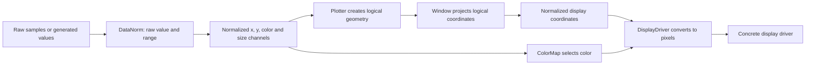
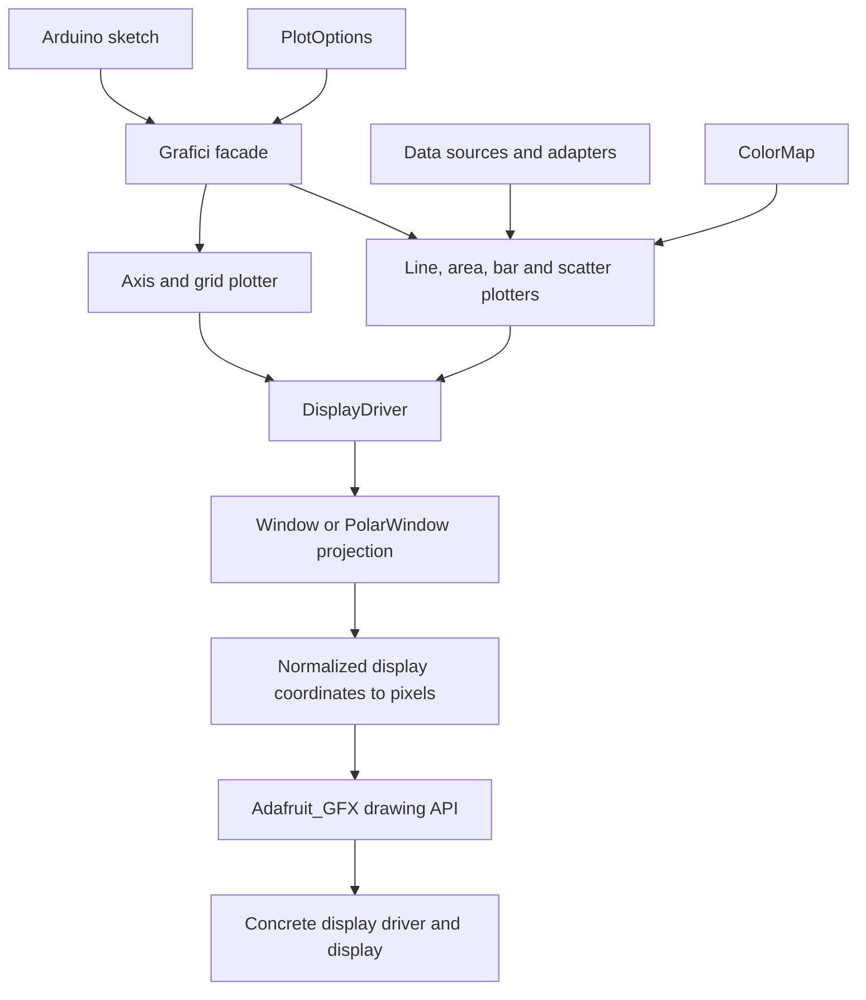
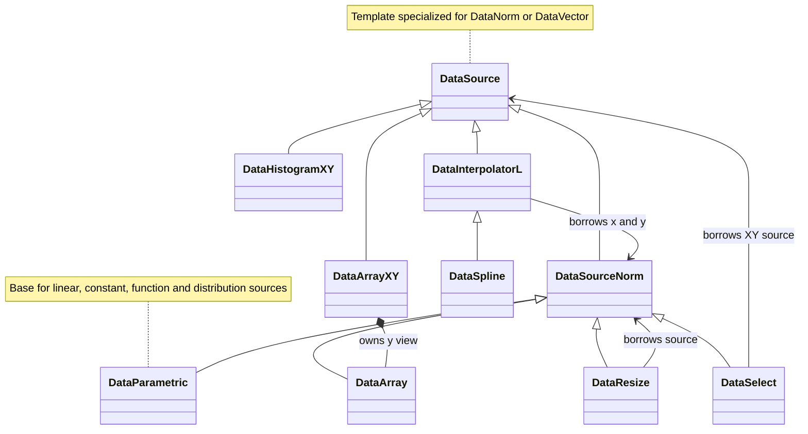
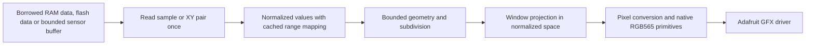

# Grafici-GFX: normalized, composable plotting

Reviewed on 18 October 2026 against commit `cc99bfc` and the current working tree. Rebased onto `origin/main` (`575ef29`) on 20 October 2026. This document describes the implementation and proposes changes. The nine correctness/portability fixes in section 5 and [selectable floating-point precision](PRECISION.md) are implemented. Section 6 records the remaining optimization proposals, with completed portions identified.

Grafici separates data production, visual encoding, coordinate projection and display hardware through a common normalized representation. A source provides values with a meaning relative to a range; a plotter turns those values into geometry; a window interprets that geometry; the display layer finally converts it to pixels. This separation lets the same sources and plotting algorithms work across data units, plot styles, coordinate systems and display resolutions.

The design also supports small devices: array views avoid copying samples, many generated sources evaluate on demand, and Grafici drawing needs no framebuffer. Efficiency improvements should preserve the normalized contracts and module interchangeability. The implementation findings and proposed changes follow the conceptual architecture below.

## 1. Design concepts

### Normalization is the interface between modules

For an increasing, non-degenerate range `[a,b]`, a raw value `v` is exposed as `u = clamp((v-a)/(b-a), 0, 1)`. For example, 20 in `[0,40]` and 2.5 in `[0,5]` both become 0.5. A plotter can use either at the midpoint of an axis without understanding temperature, voltage or their numeric scales.

`DataNorm` retains the clipped raw value and its range, exposing both `raw()` and `norm()`. Normalization supplies a common interpretation while raw values remain available to algorithms such as interpolation. Float remains the default representation; typed variants such as `DataNormT<grafici::Float16>` select a smaller floating-point representation. The normalized contract describes relative values independently of their encoding. Negative values and intermediate results above 1 are ordinary floating-point values; UNORM16 cannot replace that arithmetic contract.

Ranges therefore carry meaning. Independently autoscaled sources express relative positions within their own ranges. To compare absolute readings in the same units, the application supplies the same range to both sources. A normalized value of 0.5 alone does not imply equal raw measurements.



### Sources and plotters are independently replaceable

A source answers indexed requests through `DataSourceNorm`; it has no drawing responsibility. A plotter consumes that interface without knowing whether samples come from a C array, a function, an adapter or stored random values. Replacing an array with a function does not require a new line plotter. Reusing its x/y channels for a bar or scatter plot changes the visual encoding without changing the source implementation.

The inputs are independent channels. In `line(x, y, c)`, color can come from y, x or a separate measurement. Scatter adds another source for marker size. Reusing y as color is an application choice supported by the common interface. Samples are paired by index; normalization does not align timestamps or resample differing lengths automatically. Plotters use the shortest required channel length; scatter dots do not require a radius. Missing samples create gaps, as specified in the [boundary contracts](CONTRACTS.md).

Adapters maintain this interchangeability: `DataResize` consumes and produces a scalar source; interpolation and histograms produce XY sources whose `x()`/`y()` views re-enter the scalar interface. A histogram can consequently feed the existing bar plotter. A new source can serve existing plotters, and a new plotter can serve existing sources.

### Logical geometry and display resolution are separate

The plotters construct geometry in a logical unit square. `Window` maps this into normalized display space, including subregions and rotations. Only the final display conversion uses pixel dimensions: `px = dx*(width-1)` and `py = (1-dy)*(height-1)`, after geometric clipping in normalized display space and before signed integer conversion.

| Quantity | Interpretation |
| --- | --- |
| `x[i].norm()`, `y[i].norm()` | Relative position in the plot's logical domain. |
| `c[i].norm()` | Relative position in a color map. |
| `s[i].norm()` | Marker radius in logical coordinates; its pixel size follows projection. |
| Bar thickness | Fraction of nominal sample spacing; the logical bar width is `thickness/sample_count`. |
| Window bounds | Relative boundaries within normalized display space. |
| Source/output count and subdivision count | Discrete sampling/detail controls, independent of the number of display pixels. |

The same logical plot can therefore occupy a whole display, a subwindow or a display with a different resolution. Normalized coordinates preserve relative placement; independently scaling x and y does not guarantee a fixed physical aspect ratio or a fixed pixel-sized marker. Source indices and counts remain integers, and RGB channels use their color representation: normalization governs the interfaces and spatial meaning rather than requiring every stored number to lie in `[0,1]`.

The application can choose a sample count using display dimensions, as the animation example does, but the source/plotter interfaces do not require that relationship. Holding a generated function's domain fixed while changing sample count remains the generator's responsibility; normalization does not redefine its function argument automatically.

### Data transforms and coordinate transforms compose at different stages

`DataResize(source, {0.2,0.4})` maps the source's normalized values into that logical interval: `u` becomes `0.2 + 0.2*u`. Used as y, it creates a band within the plot. A subwindow instead places the entire plot, including its grid and geometry, inside a screen region. These operations can be combined without teaching the source about the display.

`PolarWindow` changes the interpretation of logical x/y into angle/radius. Existing line, bar, area and grid algorithms still describe their geometry in the same domain. For nonlinear projection, subdividing geometry **before** projection allows its edges to bend: projecting a logical midpoint generally differs from taking the midpoint of the projected endpoints. This explains the role of `segments()` in the architecture.

The [Cartesian functions example](examples/lines_from_functions/lines_from_functions.ino) and [polar functions example](examples/lines_from_functions_polar/lines_from_functions_polar.ino) demonstrate the composition directly. They use the same function definitions and `DataResize` bands. With a rectangular window, the bands are horizontal; with a polar window, they occupy radial bands. The changed window and subdivision options provide that reinterpretation.

## 2. Components and responsibilities

The library is header-only. [Grafici.h](src/Grafici.h) is both the public facade and the umbrella include. The sketch initializes the actual display and supplies an `Adafruit_GFX` reference.



Arrows show calls or information flow. The hardware driver determines whether drawing writes directly to a display or updates its own buffer.

| Component | Current responsibility | Main source |
| --- | --- | --- |
| `Grafici` | Holds a `DisplayDriver`, selects the active color map, dispatches plotting and grid drawing. | [Grafici.h](src/Grafici.h) |
| `DataSource<T>` | Virtual indexed access and sample count. Scalar plots consume `DataSourceNorm`. | [DataSource.h](src/data/DataSource.h), [DataSourceNorm.h](src/data/DataSourceNorm.h) |
| `DataNorm`, `Range<T>`, `Vector<T>` | Carry a clipped raw value and range; normalize, interpolate and group coordinates. | [DataNorm.h](src/data/DataNorm.h), [Range.h](src/Range.h), [Vector.h](src/Vector.h) |
| Plotters | Read sources and emit geometric primitives. `PlotAxis` draws a border and grid; there are no numeric tick labels. | [src/plotter](src/plotter/) |
| `ColorMap` | Converts a sample or palette index to RGB888 `Color`. RGB565 conversion happens in the drawing layer. | [ColorMap.h](src/color/ColorMap.h), [Color.h](src/color/Color.h) |
| `Window` | Maps normalized data into a rectangular screen region, with flips and quarter-turn rotations. | [Window.h](src/display/Window.h) |
| `PolarWindow` | Interprets normalized x as angular position in turns and y as radius, then maps through a parent window. | [PolarWindow.h](src/display/PolarWindow.h) |
| `DisplayDriver` | Builds/subdivides primitives, applies projection, converts to pixels/RGB565 and calls Adafruit GFX. | [DisplayDriver.h](src/display/DisplayDriver.h) |

### Data-source hierarchy



`DataVector` is `Vector<DataNorm>`. XY sources expose `x()` and `y()` as lightweight `DataSelect` views; these views call the underlying XY source each time, reconstructing both components even when only one is required.

| Source family | Storage and evaluation |
| --- | --- |
| `DataArray<T>` / `DataArrayXY<T>` | Borrow a C array. Automatic range detection scans it once at construction; supplying a range skips that scan. XY x-coordinates are generated from indices. |
| `DataLinear`, `DataConstant` | Generate values with constant storage. Linear range discovery uses its endpoints. |
| `DataFunction` | Stores a function pointer. Without an explicit range it scans the function during construction; plotting evaluates it again. |
| `DataResize`, `DataSelect` | Borrow another source and transform/select on access. `DataResize` maps normalized values into a subrange of `[0,1]`. |
| `DataDistributionUniform<N>`, `DataDistributionNormal<N>` | Generate once and retain `N` floats each. Despite inheriting from `DataParametric`, these are stored datasets. Constructors reseed Arduino's global RNG. The Gaussian helper also shares a cached spare value within a translation unit. |
| `DataHistogramXY<BINS>` | Builds and owns `BINS` counters at construction; subsequent reads generate bin position/count pairs. It is a snapshot, with no public recompute operation. |
| `DataInterpolatorL` | Borrows x/y sources and computes interpolated pairs on demand. Each lookup searches source intervals from the beginning. |
| `DataSpline<N, AUTOSCALE>` | Borrows x/y, stores three coefficient arrays of `N+1` floats, allocates temporary solver buffers, and evaluates on demand. `N` is the output count, although coefficient storage requirements depend on source count. |

### Ownership and update model

The sketch owns the display. `Grafici` owns its small `DisplayDriver` wrapper; that wrapper borrows the display, and `Grafici::set_color_map()` stores a borrowed pointer. Arrays and the sources referenced by adapters must outlive their views. A temporary `data.x()` view is valid during a plotting call when `data` remains alive; retaining an adapter to a temporary source is unsafe.

`PolarWindow` stores its parent as a `Window` value, so it copies the rectangular state and slices derived behavior. It is not a general chain of borrowed polymorphic windows. Polar subwindows preserve that copied parent. Rectangular subwindow helpers construct fresh rectangular objects and do not preserve an existing rotation automatically.

There is no retained scene, scheduler, or automatic redraw. Each plotting call immediately draws a complete series. Array edits and function state changes are visible on later reads, but previously discovered ranges stay unchanged. Histograms and spline coefficients also stay unchanged. Animated data needs explicit range/update semantics.

## 3. Drawing pipeline

`DataNorm` stores a raw float plus two range floats (or the selected scalar in its typed variant); it does **not** store a precomputed normalized value. Its constructor clips the raw value; `norm()` maps it into `[0,1]` on each call. Plotters pass normalized floats to the drawing layer. `Window` maps them into normalized screen coordinates; `DisplayDriver` clips projected geometry to the physical display, then scales by `width()-1` and `height()-1` and reverses y for the display's top-left origin. Missing values retain reversed range metadata and expose `valid()` without adding a storage flag.

```mermaid
sequenceDiagram
    participant App as Sketch
    participant API as Grafici
    participant Plot as plot_line
    participant Data as x, y and color sources
    participant Map as ColorMap
    participant Draw as DisplayDriver
    participant Win as Window or PolarWindow
    participant GFX as Adafruit_GFX
    App->>API: line(x, y, c, window, opts)
    API->>Draw: Draw grid if enabled
    API->>Plot: Draw series
    Plot->>Data: Read sizes and use their minimum
    loop Each adjacent sample pair
        Plot->>Data: Read both endpoints and color samples
        Plot->>Map: Map endpoint colors
        Plot->>Draw: draw_line(endpoints, colors, window, segments)
        Note over Draw: Recursively subdivide when segments exceeds one
        loop Each leaf segment
            Draw->>Win: Project endpoints
            Win-->>Draw: Normalized screen coordinates
            Note over Draw: Clip geometry; convert to signed pixels and RGB565
            Draw->>GFX: drawLine
        end
    end
```

| Plot | Geometry and ordering |
| --- | --- |
| Line | Connects adjacent samples; draws axes first. The default, unsubdivided segment uses the average of its endpoint colors. |
| Area | Fills the quadrilateral between adjacent samples and normalized y=0 using two triangles; draws axes afterward. Each quadrilateral uses its left sample's color. |
| Bar | Draws an outline or filled rectangle around each x, or a line for zero thickness; draws axes afterward. |
| Scatter | Draws one or more marker shapes per sample; draws axes first. Circles are 45-sided polygons. |
| Clear | `clear_screen()` uses native GFX fill. Passing an explicit window fills projected triangles, including subdivision and clipping. |

Area and bar baselines are the bottom of the normalized data range, which need not represent raw value zero. Projection retains floating-point coordinates outside `[0,1]`; lines/triangles are clipped geometrically to the physical display before pixel conversion. A subwindow supplies a transform; it does not add an independent clipping mask. Scatter currently does not forward `opts.get_segments()` to marker drawing.

### Cost of subdivision

For fully visible primitives with no additional clipping triangulation, let `s >= 1`, `d = floor(log2(s))`, and `L = 2^d`.

| Primitive | Backend drawing calls | Maximum recursive stack growth |
| --- | --- | --- |
| One line | `L` calls to `drawLine` | `O(log s)` |
| One filled triangle | `L²` calls to `fillTriangle` | `O(log s)` |
| One filled quadrilateral | `2L²` calls to `fillTriangle` | `O(log s)` |

`segments(45)` therefore produces 32 line segments, 1,024 triangles per filled triangle, or 2,048 triangles per filled quadrilateral. Zero silently draws nothing. Triangle work grows quadratically even though stack depth grows logarithmically. Projection and color conversion are repeated at leaves, including shared vertices. Clipping can reject a leaf or turn one filled triangle into up to five backend triangles; the table describes the unclipped case.

Subdivision is useful for nonlinear polar geometry and color gradients. For a rectangular affine projection and uniform color, it adds work without improving the intended shape.

## 4. Memory budget

Use an ATmega328P UNO R3 as an initial constrained target: it has 2 KB SRAM and 32 KB flash. The README reports testing on UNO R4 Minima; that does not establish UNO R3 fit. [Arduino UNO R3 specifications](https://docs.arduino.cc/hardware/uno-rev3)

The figures below are **payload calculations**, assuming four-byte floats and two-byte AVR `size_t`. They exclude object metadata, alignment, allocator overhead, stack, Arduino core state and the concrete display driver. Actual firmware sizes require an AVR build.

| Item | Payload | Example |
| --- | --- | --- |
| One `DataNorm` / `DataVector` | 12 / 24 bytes | Returned temporaries; ordinary sources do not retain an array of them. |
| One stored distribution | `4N` bytes | `N=300` uses 1,200 bytes, about 59% of 2 KB SRAM. |
| Histogram counters | `2BINS` bytes | 20 bins use 40 bytes. Counter capacity must cover the input count. |
| Spline coefficients | `12(N+1)` bytes | `N=100` uses 1,212 bytes before solver workspace. |
| Clipped triangle scratch | `28*sizeof(Compute)` bytes | Two seven-point buffers: 112 bytes of coordinate payload with FP32, plus locals/backend stack. No framebuffer or heap allocation. |
| Spline solver workspace | `20n+12` bytes, where `n=source_count-1` | Five buffers holding `n,n,n+1,n+1,n+1` floats. Allocation lengths are now corrected; a later rewrite can reduce workspace further. |
| Hypothetical 320×240 RGB565 framebuffer | `320×240×2` bytes | 153,600 bytes; unsuitable for this target. Grafici does not allocate this. |

The 300-point distribution example already spends most SRAM on samples alone. The two 100-point uniform distributions in the area example consume 800 bytes together. A display driver's buffer must be added separately; even a 128×64 one-bit framebuffer is 1,024 bytes.

Heap use is broader than splines: `PlotOptions` owns an Arduino `String`, its builders copy options, plotting functions take options by value, and `get_scatter_style()` returns another `String` by value. Scatter now retains that result once per draw rather than copying it inside the marker loop. The AVR core implements string storage with `realloc`/`free`, so this introduces allocation churn and possible fragmentation even for ordinary plotting. [Arduino AVR String implementation](https://github.com/arduino/ArduinoCore-avr/blob/master/cores/arduino/WString.cpp)

## 5. Correctness and portability fixes

All nine items are addressed. Spline bounds and autoscaling are combined in one patch, applied before the rebased Float16 patch. [Patch explanations and application order](patches/correctness/README.md) identify prerequisites. [CONTRACTS.md](CONTRACTS.md) specifies observable behavior and numerical limits.

| Priority | Original finding | Implemented change / patch |
| --- | --- | --- |
| Critical (fixed) | Spline `l/u/z` allocations reserved `sizeof(float)*n+1` bytes; coefficient capacity and allocation failure were unchecked. | [01: spline fixes](patches/correctness/01-spline-fixes.patch) reserves full `n+1` elements, rejects unsupported counts/zero outputs, cleans up failed allocations and bounds knot-pair reads. It also covers the autoscaling finding below and precedes `float16.patch`. |
| High (fixed) | Spline range discovery clipped overshoot before autoscaling. | [01: spline fixes](patches/correctness/01-spline-fixes.patch) evaluates unclipped scalars first, then constructs normalized samples with the discovered range. Autoscaling measures the emitted sample grid. |
| High (fixed) | Interpolation missed its final endpoint and could underflow or read beyond available knot pairs. | [03: interpolation](patches/correctness/03-interpolation-boundaries.patch) uses `i/(M-1)` for multiple outputs; one output emits the first knot. Empty/short/duplicate/reversed/non-finite knots are rejected, and uncovered outputs are missing. |
| High (fixed) | Scatter omitted radius-source length. | [04: scatter](patches/correctness/04-scatter-size-bounds.patch) bounds sized markers by x/y/color/radius. Dots remain independent; mixed styles retain dots after radii end. |
| Medium (fixed) | Generated palette indices used integer division; empty palettes were unsafe. | [05: palettes](patches/correctness/05-palette-indexing.patch) uses a floating-point fraction after wrapping indices, validates generated size and rejects `ColorMapArray<0>`. |
| Medium (fixed) | Separately truncated half-colors darkened constant colors during subdivision. | [06: colors](patches/correctness/06-color-rounding.patch) uses widened integer midpoints and nearest/ties-up linear blends. RGB565 uses integer scaling with the same floor bins as the former floating-point conversion. |
| Medium (fixed) | Ranges, empty sources/histograms, zero slices and non-finite values had inconsistent behavior; zero was ambiguous as a sentinel. | [07: contracts](patches/correctness/07-boundary-contracts.patch) adds storage-free validity queries, constant/invalid-range semantics, finite-only bounds discovery, safe empty inputs, positive-bin validation, missing-data gaps and parent-preserving polar slices. |
| Medium (fixed) | Unsigned pixel coordinates and unchecked projections could reach unsafe GFX conversions. | [08: clipping](patches/correctness/08-signed-geometric-clipping.patch) clips finite projected lines/triangles before signed `int16_t` conversion. Scratch storage is bounded. Native default clear keeps basic sketches from retaining triangle code. |
| Portability (fixed) | An example required C++17 template deduction; animation used a nonstandard lambda capture and floating-point sample count. | [09: C++11](patches/correctness/09-cpp11-portability.patch) uses explicit template arguments, integer counts and a capture-free callback. All eight examples compile under the AVR GNU C++11 recipe; the build table records flash-fit limits separately. |

## 6. Improvements within the existing design

Preserve these architectural boundaries when optimizing:

| Boundary | Optimization that preserves it |
| --- | --- |
| Sources expose normalized samples independently of plot style and hardware. | Add flash-backed sources, cache normalization constants, or change numeric encoding behind the same semantics. Keep display dimensions out of source adapters. |
| Plotters accept interchangeable scalar channels. | Cache endpoints and per-sample attributes locally. Add an optional paired reader for XY sources while retaining scalar views and the generic path. |
| Windows own coordinate interpretation. | Keep subdivision in logical space. Expose projection capabilities to the drawing layer so shortcuts are used only when they preserve the projected geometry. |
| Pixel resolution enters at the display boundary. | Keep native primitive selection and any pixel-aware sampling policy in rendering. Preserve generic rendering for arbitrary window projections. |

In particular, converting sensor values directly to pixels inside a source would couple it to a display and bypass reuse as color or size. The aim is to make the normalized pipeline cheaper to execute while retaining these independent choices.

### First: remove avoidable work and allocation

1. **Make options fixed-size and allocation-free.** Replace the marker `String` with a compact enum/bitmask; a fixed-capacity token array can preserve ordered composite markers if required. Pass `const PlotOptions&` throughout. Scatter already reads the style string once per draw. Returning it by reference would remove the remaining getter copy, but retain option-owned string allocation. Acceptance: no Grafici allocations while constructing options or drawing a basic plot.

2. **Evaluate each sample once per role.** Keep the previous line endpoint and color while advancing through a series. Today an n-point line reads x, y and color `2(n-1)` times each; when y also supplies color, it is read `4(n-1)` times. Even the constant-color overload passes y as the color source and evaluates it unnecessarily. Provide a constant-color path that skips color-source reads, retain the new per-sample bar/marker caching, and offer a paired XY reader so x/y views do not repeat interpolation. Use constant-size scratch storage. Define samples as stable within a frame, or introduce explicit snapshots for changing input.

3. **Use native primitives when geometry permits.** Draw `.` with one `drawPixel`; currently it makes 45 zero-length `drawLine` calls. Use fast vertical lines for thin bars, `fillRect` for rectangular fills. The default full-screen clear already uses native fill; explicit projected windows retain their generic path. Select shortcuts only for compatible affine windows. Use native circles only when the projected radii form a circle; retain ellipse/polar behavior where required. The GFX API already exposes these primitives. [Adafruit GFX API](https://adafruit.github.io/Adafruit-GFX-Library/html/class_adafruit___g_f_x.html)

4. **Use integer color arithmetic.** Midpoints and floor-scaled RGB565 conversion now use widened integers. A bit-packed RGB565 alternative can avoid division if changing quantization bins is acceptable. Common bit packing is `(uint16_t(r & 0xF8) << 8) | (uint16_t(g & 0xFC) << 3) | (b >> 3)`; its bins differ from the current floor-scaled quantization. Convert constant colors once per plot. Keep generated cosine palettes optional; small precomputed RGB565 palettes avoid per-channel trigonometry. Specify rounding and verify endpoint colors.

### Next: bound memory and computation

**Selectable floating-point precision is implemented.** [The precision API](PRECISION.md) provides a portable IEEE FP16 type, float aliases for existing class names, and typed source/plotter/window families. `DataArray<grafici::Float16>` compresses only the borrowed samples while retaining the float interface; selecting FP16 throughout also narrows value/range metadata, geometry and retained coefficients. Arithmetic widens to float, with rounding on storage, and spline solver scratch stays FP32. `DataCast<To, From>` bridges source families without copying buffers. FP16 preserves signed values and headroom above 1; UNORM16 remains suitable only for explicitly normalized storage. BF16 is not implemented.

**Offer optional buffering and a separate heatmap grid interface.** An RGB565 `GFXcanvas16` fits the current `Adafruit_GFX` boundary, leaving normalized sources, plotters and windows unchanged. A 128×64 monochrome buffer costs 1,024 bytes, while RGB565 costs 16,384 bytes. Reuse driver-owned buffers and prefer small regions or row/tile scratch storage on constrained targets. Heatmaps need normalized scalar-grid access independently of pixel storage: a 16×16 density grid with 16-bit counters plus one 128-pixel RGB565 output row costs 768 bytes of payload. Add a heatmap plotter that can draw projected cells directly or stream rows for supported projections. Full buffering remains optional; monochrome/indexed targets need explicit color encoding.

**Store immutable tables in flash through a storage-aware reader.** Add an explicit flash-array source and flash palette reader. On AVR, adding `const` alone is not a general SRAM-saving solution; `PROGMEM` data needs the corresponding flash-access mechanism. Keep a portable normal-memory implementation for other cores. A 32-entry RGB565 table has 64 bytes of payload in flash. [Arduino memory guidance](https://support.arduino.cc/hc/en-us/articles/360013825179-Reduce-the-size-and-memory-usage-of-your-sketch)

**Cache mapping constants at their owning stage.** A source can cache its inverse raw span; a window can cache projection constants; the display layer can reuse dimensions within a draw call. Refresh those constants when their inputs change. Integer/fixed-point normalization can preserve the same relative-value semantics if it retains the required raw/range access and defines precision and degenerate-range behavior. Pixel scaling still belongs in rendering and needs widened intermediates: mapping a 16-bit normalized span of 65,535 onto 319 pixel intervals needs a 32-bit intermediate. Additional normalized buffers should be introduced only with a measured memory budget.

**Replace repeated interval searches with sequential traversal.** For ordered x, a cursor can traverse m source points while emitting k outputs in `O(m+k)` total work, rather than the current worst-case `O(mk)`. Keep the cursor local to a rendering traversal; do not hide mutable global progress in a const random-access source. If arbitrary access is required, binary search gives `O(log m)` interval selection. Separate spline source capacity from output resolution, use caller-owned workspace, and evaluate cubics with Horner's rule.

**Give subdivision a hard work budget.** Replace implicit power-of-two rounding with documented semantics and bounded iteration. Use exact segment counts for lines, or bounded adaptive subdivision driven by projected pixel error. Filled polar shapes need a separate triangle budget; sharing the line's setting currently permits quadratic growth. Reuse projected vertices. For fixed polygon markers and repeated polar angles, compare a small flash lookup table or incremental rotation against trigonometry. Avoid allocating a general mesh.

**Offer resolution-aware rendering without coupling sources to pixels.** For monotonic-x time series with a compatible projection, an optional rendering policy can aggregate min/max per pixel column so spikes survive. Keep source resolution independent, retain the generic path, and process samples without storing another full dataset. Incremental strip updates or a bounded ring buffer can support live sensors. Draw static grids once and restore only affected regions; erasing an old curve in black can damage grids and overlapping plots.

### Then: reduce fixed overhead where measurement justifies it

Keep the virtual source/window API initially: replacing it is a larger compatibility change than removing duplicate evaluation. An optional templated fast path may enable inlining, but many instantiations can increase flash. Measure both flash and runtime before adopting it.

Make base colors compile-time constants where possible, provide one definition of shared palettes/default objects, and separate the small core include from optional distributions, splines and generated palettes. Header-defined `const` objects have internal linkage and can be duplicated across translation units; dynamically initialized objects can retain startup work. Check the linker map rather than assuming every included function occupies flash. Add direct includes so public headers do not depend on Arduino's implicit prelude or umbrella include order.

A suitable target pipeline preserves the current normalized contracts:



The remaining pipeline optimizations are proposals. The implementation still uses per-access normalization, string options and recursive subdivision; integer color arithmetic and native default clearing are already implemented.

## 7. Verification and acceptance criteria

The repository points to a separate [Grafici-Test repository](https://github.com/cattanimarco/Grafici-Test); those tests are not included or run here. The initial review used host checks. The precision follow-up added isolated Uno R3 builds with the real AVR compiler and installed display libraries; [linked flash and static SRAM comparisons](PRECISION.md#verification) are recorded separately. No physical board/display timing or runtime stack/heap measurements were made.

The initial pre-fix host harness used C++11, an Arduino compatibility shim and a counting GFX stub. These historical observations motivated the patches; the fixed implementation changes endpoint, palette and clear behavior:

| Check | Observed result |
| --- | --- |
| Four-point line with y also used as color | 6 x reads, 12 y reads, 3 backend lines. |
| Four-point constant-color line | Still 6 x reads and 12 y reads. |
| Four dot markers | 180 backend lines and no direct pixel call. |
| `segments(45)` | 32 backend lines for one line; 1,024 backend triangles for one triangle. |
| `clear_screen()` with `segments(45)` | 2,048 backend triangles and no `fillScreen` call. |
| Four outputs interpolating endpoints 0 and 1 | Last normalized x is 0.75. |
| Generated palette with size 100 | Indices 0 and 50 produce identical RGB. |
| Original three-source-point spline, before the bounds patch, with padded, guarded solver allocations | Two buffers overwrite bytes beyond their requested allocation sizes. |

These initial observations are call counts and functional checks, not timing or AVR memory benchmarks. The spline check substituted an allocator that physically padded each request and inspected guard bytes afterward. AddressSanitizer runs, including a retry after the patch, timed out in this environment; there is no completed AddressSanitizer report.

The follow-up [spline regression check](tests/data_spline_bounds.cpp) fails against the original implementation and passes after the patch, both normally and with UndefinedBehaviorSanitizer. It covers workspace guards and lengths, linear/curved interpolation, the coefficient-capacity boundary, empty/single-point and zero-output inputs, oversized input, all five allocation-failure positions and an uncovered x range. [Host test instructions](tests/README.md)

The completed checks now cover all ten host regressions and both expected compile-time rejections; run `python3 tests/run_checks.py --sanitize`. Actual GFXcanvas16 checks confirm clipped-triangle coverage, horizontal-line rasterization and native clear for float/FP16. [The patch-series build audit](patches/correctness/README.md) records real AVR C++11 compilation and linked sizes for all eight examples.

For further performance work, use a small reference sketch with caller-owned integer samples, one rectangular line and one bar plot. Compare it against the same sketch using only its display driver. On UNO R3, record flash, `.data + .bss`, worst observed stack/heap headroom and frame time on the same display/bus. A useful starting constraint is at least 512 bytes left for stack/interrupt headroom after accounting for peak heap use; adjust it using measured worst-case behavior rather than treating it as a proof of safety.

Run focused regressions for spline bounds, empty/single-point inputs, interpolation endpoints, constant/reversed ranges, marker length mismatches, clipping and RGB conversion. Check long-running redraws for stable memory use. Time data processing separately from display transfer, and compare rectangular/polar plots plus small/large markers. Where supported, assess transaction-aware `startWrite`/`write*`/`endWrite` batching against the concrete driver; simply wrapping existing high-level primitives may cause nested transactions.

The first measurable goals should be zero Grafici heap allocations in the basic path, one backend pixel call per dot, no redundant color-source evaluation for constant colors, constant-size line scratch storage, and explicit upper limits on spline storage and subdivision work.
