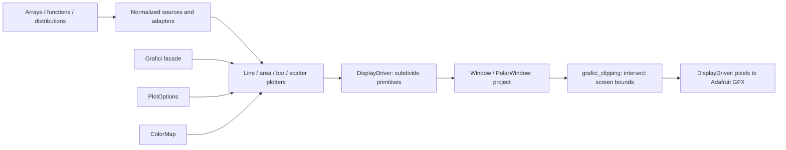
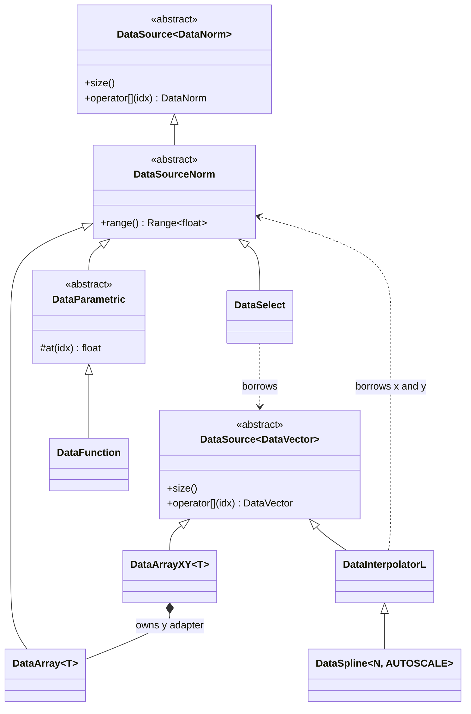
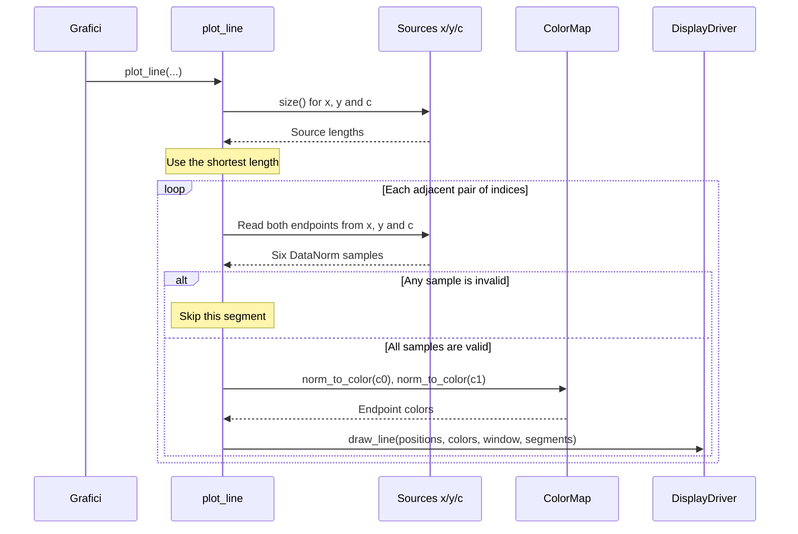
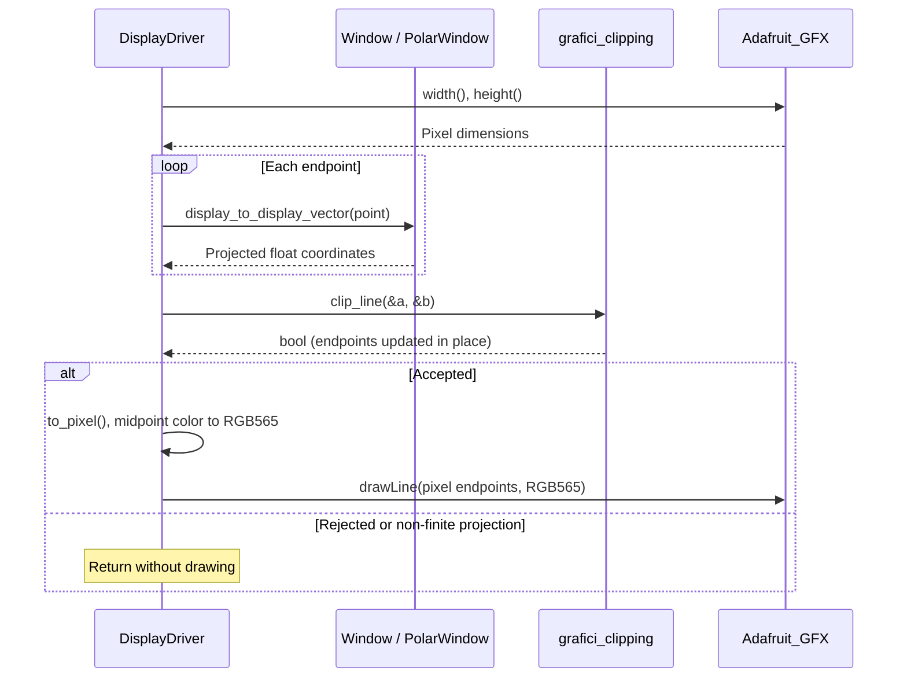

# Contributing to Grafici-GFX

This guide follows the [wiki's Library Concepts](https://github.com/cattanimarco/Grafici-GFX/wiki#library-concepts): start with a plot, then look at the objects that make it work. The [README](README.md) covers installation and the first drawing examples.

For agent-assisted changes, use [grafici-contribute](.agents/skills/grafici-contribute/SKILL.md). [AGENTS.md](AGENTS.md) routes library work and sketch debugging to the relevant skills; this guide remains the reference for design contracts and documentation style.

## Architecture

We can start with the same two lines we use in a sketch:

```cpp
Grafici plot{gfx};
plot.line(x, y, color, full_screen);
```

`Grafici` connects the display driver to a plotter. `x`, `y` and `color` are data sources, and `full_screen` is a window. We can replace any of those sources, choose another plotter, or use a polar window while keeping the other pieces.

The common interface is normalization. Sources describe positions within their ranges, plotters build geometry from those positions, and windows project it onto the display. Pixel dimensions enter at the end.



The arrows after the plotters show the path of geometry. `DisplayDriver` calls the window and clipping helpers, then sends pixel primitives to the Adafruit GFX backend. Sources know nothing about the display's resolution or plot style.

### Normalized interfaces

A source behaves like a small indexed sequence: we can ask for its `size()` and read a sample with `operator[]`. A scalar sample is a `DataNorm`, which contains a raw float value and a `Range<float>`.

For example, five signed measurements can occupy the whole height of a plot:

```cpp
const int readings[] = {-10, -5, 0, 5, 10};
DataArray<int> source(readings, 5);
// source[1].raw() == -5; source[1].norm() == 0.25f
```

The inferred range is `[-10,10]`. The values become:

| Raw value | Normalized position |
| --- | --- |
| -10 | 0.00 |
| -5 | 0.25 |
| 0 | 0.50 |
| 5 | 0.75 |
| 10 | 1.00 |

`Range::value_to_norm()` makes that conversion; `normalized_to_value()` maps a normalized position back to the range. Both clamp finite inputs at the boundaries. A constant valid range normalizes to zero. `norm_to_value()` remains a forwarding alias for existing sketches.

The `int` in `DataArray<int>` describes the borrowed array. Samples become float-backed `DataNorm` values when read. Raw values, slopes and spline coefficients can be negative or exceed one. `DataNorm` clips a raw input to its supplied range; intermediate geometry remains unclamped until the display boundary.

> Inferred bounds are found during construction. Changing an array or callback state does not refresh them. Supply an explicit range when the scale must stay fixed across redraws or several sources.

### Sources and composition

[DataSource<T>](src/data/DataSource.h) supplies the indexed interface. `DataSourceNorm` derives from `DataSource<DataNorm>` and adds range metadata. Paired sources implement `DataSource<DataVector>`, where `DataVector` is `Vector<DataNorm>`.

We can see why this split helps by drawing a hype cycle: a peak of enthusiasm, a trough, and a gradual recovery. Six milestones are enough to describe it. `DataArrayXY` pairs their indices with the values, and `DataSpline` fills in the curve between them.

<!-- grafici-example: hype-cycle -->
```cpp
void draw_hype_cycle(Grafici &plot) {
  const int milestones[] = {0, 100, 20, 50, 60, 60};
  DataArrayXY<int> samples(milestones, 6);
  const auto sample_x = samples.x();
  const auto sample_y = samples.y();
  DataSpline<48> curve(sample_x, sample_y);
  const auto x = curve.x();
  const auto y = curve.y();

  plot.clear_screen();
  plot.set_color_map(parula);
  auto left = full_screen.sub_window({0.04f, 0.48f}, {0.08f, 0.92f});
  auto right = full_screen.sub_window({0.54f, 0.98f}, {0.08f, 0.92f});
  auto opts = plot_options.set_axis(2, 5, gunpowder);
  plot.line(sample_x, sample_y, sample_y, left, opts);
  plot.line(x, y, y, right, opts);
}
```


The left plot joins the six milestones; the right plot reads 48 spline samples. The spline discovers its own output range, including sampled overshoot, so each panel uses its source's scale.

The named x/y views matter. `DataSelect` borrows its vector source, and the spline borrows its scalar knot sources. Passing `samples.x()` and `samples.y()` directly to a stored spline would leave it referring to temporary views after construction. Here, the array, sources and views all remain alive until drawing finishes. Keep the knots stable as well, and rebuild a spline when they change.

The class diagram shows these relationships. Triangles mark inheritance, the diamond marks an owned adapter, and the labelled arrows show borrowed references.



`DataArrayXY` owns its y adapter; that adapter still borrows the original array. `x()` and `y()` return views by value, without copying a sample buffer. Reading both views can evaluate the same vector sample twice, so indexed reads should be repeatable and reasonably cheap.

Other source families follow the same interfaces:

| Source | What changes |
| --- | --- |
| `DataParametric`, `DataFunction`, `DataLinear`, `DataConstant` | Compute a raw value through `at()` and wrap it in the source range. Inferred function bounds require a construction-time scan; explicit bounds avoid it. |
| `DataResize` | Maps a scalar source's normalized values into another interval. It keeps the sample count and returns unit-range samples, preserving the new amplitude. |
| `DataInterpolatorL` | Locates the surrounding knots and computes each requested output. `DataSpline` adds stored cubic coefficients. |
| `DataDistributionUniform<N>`, `DataDistributionNormal<N>` | Generate and retain `N` float samples during construction. |
| `DataHistogramXY<BINS>` | Counts valid samples into fixed bins during construction, then exposes positions and counts or frequencies. Rebuild it when the input changes. |

### Plotters, colors and options

A plotter decides what geometry the samples mean. A line joins neighbors; an area fills down to normalized zero; a bar starts at the same baseline; scatter uses another source for marker radius. Raw zero is not necessarily the baseline: normalized zero represents the range's lower bound.

`Grafici::line()` passes sources, a palette, a window and options to the free function `plot_line`. With axes disabled, the calls look like this:



The plotter checks both endpoints before drawing. A missing coordinate or color leaves a gap. Dots need no radius sample, while sized scatter markers require one. Source reads are virtual, so an array, callback or adapter can supply the same plotting call.

A [ColorMap](src/color/ColorMap.h) maps the independent color channel to RGB. `ColorMapArray<N>` owns palette entries, `GeneratedMapGenerated` computes a cosine palette, and `ColorMapConstant` supplies one color. `Color` stores 8-bit channels; the driver converts to RGB565 for the backend.

`Grafici::set_color_map()` borrows the palette. Keep it alive for subsequent calls. Fixed-color overloads create a local constant map for that call. Array/generated palettes wrap discrete indices, and invalid normalized input maps to black.

`PlotOptions` returns modified copies, which makes chains such as `plot_options.segments(4).bar_filled(true)` convenient to pass directly. Assign the result when saving options. Its marker style uses Arduino `String`, so copying options can allocate.

### Windows and coordinate flow

The [README's polar example](README.md#wrap-the-wave-around-a-circle) changes the window while keeping the data and plotter. This is the boundary a new projection should preserve:


A [Window](src/display/Window.h) maps local `(0,0)` to its lower bounds and `(1,1)` to its upper bounds. For example, `Window inset{{0.1f, 0.9f}, {0.2f, 0.8f}}` leaves a margin around the same plot at any resolution. `sub_window()` selects a smaller region; rotation and flips act on local coordinates before the range mapping.

[PolarWindow](src/display/PolarWindow.h) treats x as an angle in turns and y as radius. It computes Cartesian coordinates around `(0.5,0.5)`, then maps them through its stored parent window. Radius one reaches the unit square's edges before that parent mapping.

`DisplayVector` contains float coordinates with a bottom-left origin. The driver subdivides geometry before projection so long segments can follow curved windows and interpolate colors. Recursion halves the requested segment count; powers of two give predictable counts. More segments cost backend calls and stack space, without adding source samples.

For a valid line with `segments == 1` and positive display dimensions, the final path is:



[grafici_clipping](src/display/Clipping.h) is a namespace of helper functions. It clips projected lines with Cohen-Sutherland and triangles with Sutherland-Hodgman. Finite points outside `[0,1]` remain available for intersection; non-finite projections are rejected. Clipping uses the physical display rectangle, so markers can extend beyond a subwindow.

Only then does the driver convert to signed `int16_t` pixels: x scales by `width-1`, and y is reversed and scaled by `height-1` for Adafruit GFX's top-left origin. Invalid windows or projections draw nothing. The default `clear_screen()` uses the backend's native fill; an explicit window uses projected rectangle rendering.

## Extending a module

To add a computed scalar source, derive from `DataParametric` and implement `at()`. As an example, a chirp squeezes more oscillations into the end of the plot by making phase grow quadratically:

<!-- grafici-example: chirp -->
```cpp
class Chirp : public DataParametric {
public:
  explicit Chirp(size_t count) : DataParametric(count, {-1.0f, 1.0f}) {}

protected:
  float at(size_t i) const override {
    const float t = size() > 1 ? float(i) / float(size() - 1) : 0.0f;
    return sinf(24.0f * t * t);
  }
};

void draw_chirp(Grafici &plot) {
  DataLinear x(96);
  Chirp y(96);
  plot.clear_screen();
  plot.set_color_map(parula);
  plot.line(x, y, y);
}
```


The base class checks indices and wraps each raw result in the supplied range. The explicit bounds avoid a discovery pass. For an inferred range, call `update_range()` after the derived members are initialized. Derive directly from `DataSourceNorm` when adapting another source needs different indexing or metadata.

Choose the corresponding boundary for other additions:

| Addition | Extension point |
| --- | --- |
| Paired source | Implement `DataSource<DataVector>` and expose coordinates through `DataSelect`. Return invalid samples for unavailable indices. |
| Plot type | Add a `plot_*` free function and facade overloads. Bound all consumed sources, check validity and emit normalized primitives; decide axis draw order in `Grafici`. |
| Projection | Derive from `Window` and override its float-coordinate projection. Preserve parent behavior where applicable and leave finite off-screen points for clipping. |
| Palette | Implement `index_to_color()` and `norm_to_color()`. Keep channel conversion bounded and make storage/computation costs clear. |
| Display backend | Implement the Adafruit GFX interface. [File_GFX](https://github.com/cattanimarco/Grafici-Test/blob/d46495439394908570d4ca1df2ae1316bee40c09/File_GFX.h) shows how to render into image files. |

Keep C++11 compatibility. Templates select element types and fixed capacities; runtime interfaces let those implementations work with existing callers. Make ownership explicit, reuse the `invalid()` factories, and avoid adding a cache or allocation to every source to support one implementation.

## Rendering and memory

The spline above computes samples on demand but still retains coefficients. With 48 outputs, its three `float[49]` arrays occupy 588 bytes. For six knots, construction also needs 112 bytes of solver arrays, excluding allocator overhead. This is why output count is a memory choice as well as a visual one.

Budget retained storage, construction-time workspace and drawing-time stack separately. Object metadata, allocator overhead and the display backend add to these payloads:

| Component | Payload and computation |
| --- | --- |
| Arrays and computed sources | Arrays are borrowed. Function/linear/constant sources avoid a second sample array; inferred array/function bounds require a scan at construction. |
| Distributions and histograms | Distributions retain `4*N` bytes of float samples. Histograms retain `BINS*sizeof(size_t)` bytes of counts and scan input at construction. |
| Spline | Coefficients use `12*(N+1)` bytes. With `n = source_count-1`, temporary solver arrays use `20*n+12` bytes. Capacity/allocation failure leaves an empty source and releases partial workspace. |
| Triangle clipping | Two seven-point buffers use 112 bytes of float coordinate payload, plus locals and backend stack. Fully visible triangles are emitted directly. |
| Options and callbacks | Arduino `String` copies and opt-in `std::function` callbacks may allocate. Captured references must remain alive; set `GRAFICI_USE_STD_FUNCTION` consistently across translation units. |

Use known ranges when they avoid discovery work, keep subdivision modest, and measure repeated reads before adding a bounded cache. Display transfers can dominate arithmetic, so measure them separately from source evaluation.

Grafici does not retain a framebuffer. A 128-by-64 frame would need 1,024 bytes in monochrome or 16,384 bytes in RGB565, in addition to the display driver's buffers. Scanline or tile rendering can be a better fit for small boards; a heatmap only needs a retained scalar grid when its algorithm requires one. Measure flash and peak SRAM on the target hardware before choosing that storage.

## Documentation guidelines

Use the wiki's practical walkthrough style when changing these guides:

- Start with a small public API example, identify its objects, then explain how they work together.
- Explain what a module represents and why it is useful before describing its methods. Assume basic C++ knowledge and use familiar comparisons when they help.
- Write as a shared walkthrough: we create a source, change a plotter, then inspect the result. Keep paragraphs direct and conversational.
- Introduce one idea at a time through short code snippets and explain their visible or numeric output nearby. Reuse an example as it grows.
- Choose interesting functions and recognizable shapes: beats, chirps, polar patterns or a hype cycle. Keep their computation and memory cost suitable for small Arduinos.
- Generate every plot image in Grafici-Test from the documented example. Regenerate it when the code changes and use its published URL in Markdown. Preserve the example markers used by the renderer.
- Keep the README focused on getting a plot running and discovering the main features. Put internals, contracts and resource accounting here.
- Use class or sequence diagrams where relationships or call order need explaining. Reserve tables for values, comparisons and reference contracts; notes should clarify a specific assumption.

Correct spelling, grammar and outdated API usage while preserving the teaching sequence and the author's voice. Keep measured results distinct from estimates, and keep examples consistent with the current code.

## Verification

The rendering gallery and image generator live in [Grafici-Test](https://github.com/cattanimarco/Grafici-Test/tree/d46495439394908570d4ca1df2ae1316bee40c09). From its `codex/documentation-images` branch, generate these pictures against the library checkout being documented:

```sh
python3 docs/render.py --library /path/to/Grafici-GFX --sanitize
```

The renderer extracts the marked C++ examples from these Markdown files, compiles them against Grafici and the file display backend, and writes PNGs and a provenance manifest to `imgs/guides/`. Hardware initialization is replaced with the file backend. Review the pictures before publishing, and link to the image commit so a later regeneration cannot silently change this guide.

For library changes, exercise empty/invalid inputs and the first/last indices for new sources. Check emitted geometry and gaps for plotters and projections; pictures alone cannot establish those contracts. Compile representative examples with the target board's toolchain as well. Host checks and board builds do not measure physical display timing or peak SRAM.

## Boundary and invalid-data contracts

These contracts add no per-sample flag or buffer. `DataNorm` still stores three floats (12 bytes): one raw value and two range bounds. Floating-point values can represent signed values and intermediate results outside `[0,1]`.

| Boundary | Contract |
| --- | --- |
| `Range<T>` | Finite, ordered bounds (`low <= high`) are valid. A constant range is valid, normalizes every finite value to zero, and maps every finite normalized input to its single value. |
| Reversed ranges | Invalid until explicitly sorted. `contains()` returns false. Invalid/non-finite mapping inputs return zero as a deterministic fallback; query `valid()` before using that fallback as data. `normalized_to_value()` still clamps finite normalized inputs at 0 and 1. |
| Range accumulation | Start with `Range<T>::invalid()`. `update()` initializes an invalid accumulator from the first finite value and ignores NaN/infinity. `delta()` returns float, avoiding signed-integer overflow for wide integer ranges. |
| `DataNorm` | Default construction and `DataNorm::invalid()` represent missing data. `valid()` distinguishes missing data from a legitimate zero or constant range. Raw NaN/infinity or invalid supplied ranges produce missing data. Finite raw values still clip to an explicit valid range. |
| Source metadata | `DataSourceNorm::valid()` means nonempty with valid range metadata; individual samples can still be missing. Arrays/functions discover bounds from representable finite values. Empty/all-missing inferred sources have invalid ranges. Null array pointers and null function callbacks expose size zero. Explicit range metadata can remain valid on an empty source; its size still reports zero. |
| `DataLinear` | Zero outputs do not evaluate `size-1`. Inferred bounds sort finite endpoints, so negative slopes are supported. An unrepresentable inferred endpoint produces an empty source. |
| Interpolators/splines | Borrowed sources must remain stable and outlive the interpolator. At least two finite, strictly increasing x knots are required; y may be constant or decrease. Invalid knots produce size zero. `M>=2` includes normalized endpoints; `M=1` emits the first knot. A sample outside the supplied knot coverage is missing. Spline solver failure or non-finite coefficients produce size zero; non-finite/unrepresentable evaluations are missing. Autoscaling measures emitted samples, not continuous extrema between them. |
| Histograms | `BINS` must be positive at compile time. Missing input samples do not contribute to counts or the normalized denominator. An empty histogram retains its bins, all containing valid zero counts/frequencies. Zero class count or `class_id >= num_classes` produces size zero. Group coordinates use floating-point computation before pixel or data conversion, avoiding integer-product overflow. |
| Windows | Finite, ordered boundaries are valid, including collapsed ranges. Zero slice counts, out-of-range slice indices and invalid subranges produce an invalid window. `valid()` reports this state; projection of invalid input/window metadata returns `DisplayVector::invalid()`, which contains NaN coordinates, and drawing rejects invalid windows. Polar subwindows retain their parent window. |
| Plotters | Missing samples create gaps: lines/areas omit segments touching a missing coordinate or color, bars omit that sample, and scatter omits that marker. Dots do not require a radius; other markers also require a valid, available radius. Invalid/non-finite bar thickness produces no bars. No unbounded cache or validity buffer is created. |
| Display boundary | Project logical geometry without per-vertex clamping. Intersect projected lines/triangles with the physical display rectangle in float, reject non-finite projections, then convert to signed `int16_t` pixels. Zero/negative display dimensions draw nothing. Clipping uses the physical display rectangle; markers can extend beyond a subwindow if still on display. |
| Palettes | Array/generated maps return black for invalid normalized input. A zero-size generated palette reports invalid and returns black. Cosine-generated channels clamp to `[0,255]` before integer conversion. Linear color blends round to nearest, with ties upward. |

For example:

```cpp
DataNorm missing;
DataNorm zero(0, {0, 0});
// !missing.valid(), zero.valid(), zero.norm() == 0

const float readings[] = {NAN, 10, 20};
DataArray<float> source(readings, 3);
// Inferred range [10,20]; source[0] is missing. Plotters leave a gap.
```

Use `DataNorm::invalid()` or `DataVector::invalid()` to construct missing samples explicitly. The `INVALID_RANGE_FLOAT`, `INVALID_DATA_NORM` and `INVALID_DATA_VECTOR` macros remain compatibility aliases for their respective factories.

`Range<T>::invalid()` defines the invalid range representation. Use the factories to construct invalid values and `valid()` to inspect them. Calling `norm()` on missing data returns zero for compatibility with arithmetic callers; that zero does not make the sample valid.

Spline construction retains its bounded heap workspace; these contracts do not remove it.

Pixel conversion preserves truncation toward zero after clipping to `[0,1]`; integer pixel endpoints remain within `[0,width-1]` and `[0,height-1]`. Subdivision still happens before projection, preserving the existing polar/custom-window approximation. A clipped triangle can become a convex polygon with at most seven vertices; two seven-point buffers use 112 bytes of coordinate payload with FP32 computation, plus locals and backend call stack. This is bounded scratch storage, with no heap allocation or framebuffer.

`plot.clear_screen()` uses the native GFX fill. Passing an explicit window retains projected rectangle rendering, including clipping and any requested subdivision. The native default avoids retaining the triangle renderer in simple line sketches.
