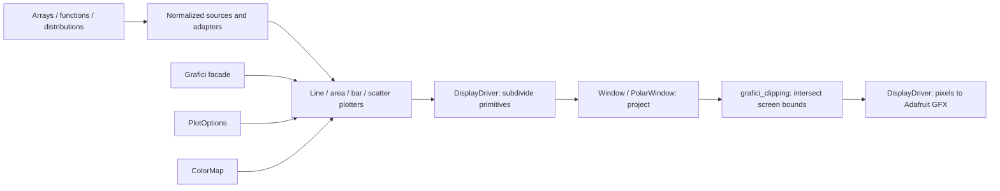
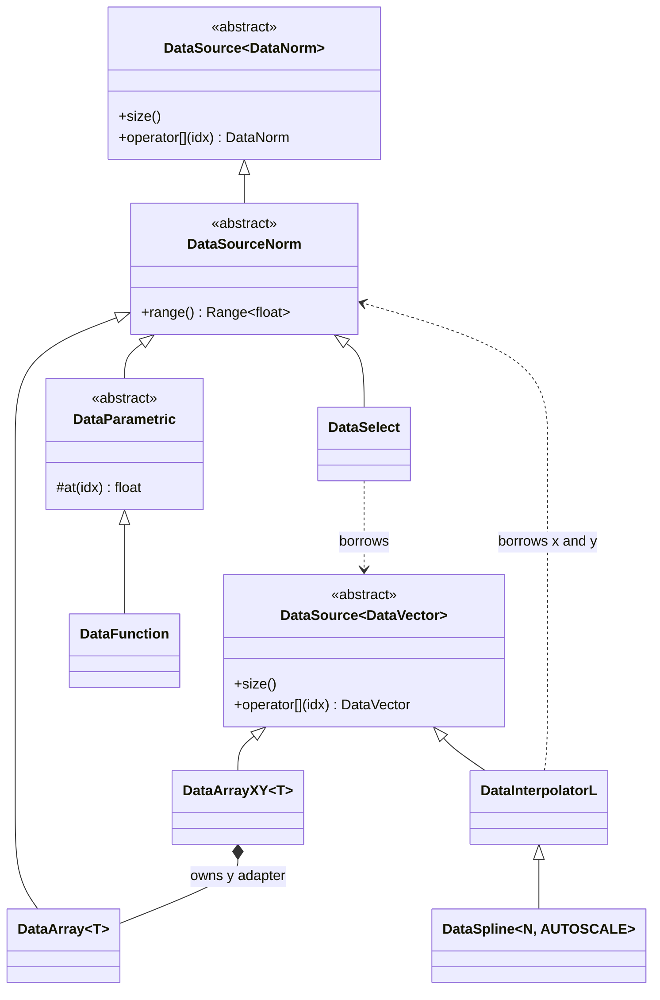
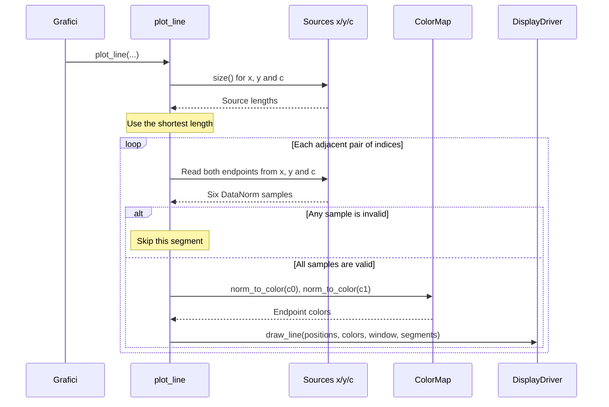
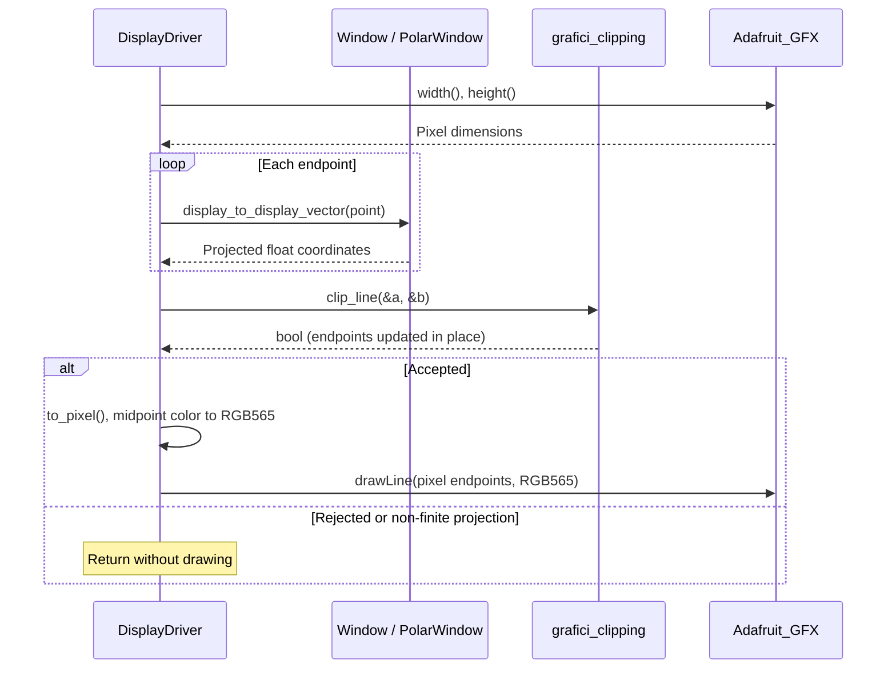

# Contributing to Grafici-GFX

This guide explains how the modules fit together and the contracts to preserve when extending them. It builds on the wiki's [Library Concepts](https://github.com/cattanimarco/Grafici-GFX/wiki#library-concepts), with implementation details checked against this branch. Installation and display setup are covered in the [README](README.md).

## Architecture

Sources, plotters and projections are independent. The same source can drive a line, bars, colors or marker sizes; the same plotter works with Cartesian and polar windows. Normalization provides the common interface between them, leaving display resolution to the final drawing stage.



The arrows after the plotters show the path of geometry. `DisplayDriver` calls the supplied window and clipping helpers before sending pixel primitives to the backend.

| Module | Responsibility and boundary |
| --- | --- |
| [Grafici](src/Grafici.h) | Public facade. Selects the configured or constant palette, invokes plotters and arranges axis drawing. Holds a `DisplayDriver` and a pointer to the selected color map. |
| [Data sources](src/data/) | Expose indexed values, sizes and normalization metadata. Sources know nothing about display dimensions or plot styles. Adapters let existing sources be composed without changing plotters. |
| [Plotters](src/plotter/) | Free functions that turn normalized samples into lines, rectangles and markers. They check sample validity and pass geometry to `DisplayDriver`. |
| [Windows](src/display/Window.h) | Map geometry into a display region or another projection. They operate on floating-point coordinates, independently of pixel dimensions. |
| [DisplayDriver](src/display/DisplayDriver.h) and [clipping](src/display/Clipping.h) | Build/subdivide primitives, apply the window, clip projected geometry and convert to signed pixels before calling Adafruit GFX. |
| [Colors and palettes](src/color/) | Map an independent data channel to RGB colors. `Color` holds 8-bit channels; RGB565 conversion happens when emitting backend drawing calls. |

### Normalized interfaces

`Range<T>` describes the bounds used for normalization. `DataNorm` carries a float raw value and a range; `raw()` retrieves the stored value and `norm()` retrieves its normalized position. For ordinary array and parametric sources, all samples use the source's common range, making their normalized positions comparable.

```cpp
const int readings[] = {20, 30, 60};
DataArray<int> source(readings, 3); // Inferred range [20,60].
// source[1].raw() == 30; source[1].norm() == 0.25f
```

`value_to_norm()` maps a value into `[0,1]`; `normalized_to_value()` maps a normalized position back onto the range. Both clamp finite inputs at the range boundaries. Supplying an explicit range fixes the scale across redraws or multiple sources. Bounds inferred by `DataArray` and `DataFunction` are discovered during construction and are not automatically refreshed when the underlying array or callback state changes.

The `T` in `DataArray<T>` describes the borrowed array's storage type; samples are converted into float-backed `DataNorm` values when read. Normalization does not restrict the floating-point format itself: raw measurements can be signed, and intermediate geometry, slopes and spline coefficients can exceed one. `DataNorm` clips finite raw input to its supplied valid range, while geometry must remain unclamped until it is intersected with the display.

### Sources and composition

[DataSource<T>](src/data/DataSource.h) is an abstract indexed sequence: `size()` reports its length and `operator[]` returns a sample by value. It does not require a sample buffer. `DataSourceNorm` specializes it for `DataNorm`, adds range metadata and supplies the conversion helper used by ordinary scalar sources. `DataSource<DataVector>` represents paired x/y data; `DataVector` is `Vector<DataNorm>`.

This diagram shows the interfaces and representative implementations. Triangles mark inheritance, the diamond marks an owned adapter, and arrows labelled "borrows" require their targets to remain alive.



| Source family | How it produces or adapts samples |
| --- | --- |
| `DataArray<T>`, `DataArrayXY<T>` | Borrow a C array. `DataArrayXY` combines array values with index-based x coordinates; it does not copy the array. |
| `DataParametric`, `DataFunction`, `DataLinear`, `DataConstant` | `DataParametric::operator[]` checks bounds and wraps the raw float returned by `at()`. Function callbacks run when read; linear and constant sources compute values without retaining a sample array. |
| `DataDistributionUniform<N>`, `DataDistributionNormal<N>` | Fill an owned `float[N]` during construction and reuse those samples on subsequent reads, despite deriving from `DataParametric`. |
| `DataSelect` | Borrows a vector source and exposes its x or y component as a scalar source. The `x()` and `y()` methods on vector sources return these views by value. |
| `DataResize` | Borrows a scalar source and maps its normalized values into a configured interval. Returned samples use the unit range, preserving the remapped amplitude when plotted. It does not change sample count. |
| `DataInterpolatorL`, `DataSpline<N, AUTOSCALE>` | Borrow x/y sources and emit a new sample sequence. Linear interpolation locates a knot interval on each read. Splines retain cubic coefficients computed during construction; autoscaling scans emitted raw y values before wrapping them in `DataNorm`. |
| `DataHistogramXY<BINS>` | Counts valid normalized samples into fixed bins during construction. It exposes bin positions and either counts or frequencies through x/y views. Rebuild it when the input distribution changes. |

Composition borrows references. Keep arrays, sources and intermediate views alive until their consumers finish. Keep interpolation inputs stable while an interpolator uses them; rebuild the spline if knots change. Reading x and y views separately can evaluate the same vector source twice, and line plotters revisit neighboring indices, so an indexed read should be repeatable and reasonably cheap.

`DataFunction` with inferred bounds calls every callback index during construction, then calls it again when samples are read. Use an explicit range to avoid that discovery pass when the bounds are known or callback state changes. Raw function pointers are the default; optional `GRAFICI_USE_STD_FUNCTION` support stores capturing callbacks by value and can allocate. References captured by a callback must remain alive.

### Plotters, colors and options

For `plot.line(x, y, c, window, opts)`, the facade passes the selected palette and the sources to `plot_line`. The plotter uses the shortest input length, reads adjacent samples, skips segments touching invalid samples and calls `DisplayDriver::draw_line` with normalized positions and mapped endpoint colors. The color source `c` can be unrelated to x or y; using y for color is just one possible encoding.

With axes disabled, source reads and drawing follow this sequence. `plot_line` is a free function; reads dispatch through the source interfaces.



Area plots fill between adjacent samples and normalized `y=0`; bars also start at normalized zero, which represents the source range's lower bound rather than necessarily raw zero. Scatter interprets an additional source as normalized marker radii. Dots need no radius sample; sized markers must respect that source's available length. Plotters define these geometric rules, while windows define where the resulting geometry appears.

`ColorMapArray<N>` owns a fixed palette and interpolates between entries for normalized input. `GeneratedMapGenerated` computes a cosine palette without retaining a color table; `ColorMapConstant` returns one color. Index-based palette access wraps through the discrete palette. `Grafici::set_color_map()` borrows the palette, so it must outlive subsequent drawing calls. The fixed-color drawing overloads create a local constant map for that call.

`PlotOptions` contains subdivision, axis, bar and scatter settings. Its fluent methods return modified copies: assign or pass the returned value, for example `plot_options.segments(8).bar_filled(true)`. Options include an Arduino `String` for marker styles, so copying options is not guaranteed to be allocation-free.

### Windows and coordinate flow

A Cartesian window maps local `(0,0)` to its lower bounds and `(1,1)` to its upper bounds. For example, `Window inset{{0.1f, 0.9f}, {0.2f, 0.8f}}` maps the same plot into an inset rectangle at any display resolution. `sub_window()` partitions that rectangle using normalized subranges or slice indices. Rotation and flip settings act on local coordinates before they are mapped into the window's ranges.

[PolarWindow](src/display/PolarWindow.h) interprets x as an angle in turns and y as radius, applies its angle/radius ranges, computes Cartesian coordinates around `(0.5,0.5)` and maps those through its stored parent window. Before the parent mapping, radius one reaches the edges of the unit display square. Changing the projection therefore does not require changing a data source or plotter.

`DisplayVector` is `Vector<float>` and uses normalized display coordinates with a bottom-left origin. `PixelVector` uses signed `int16_t` coordinates; the final conversion reverses y for Adafruit GFX's top-left origin and scales to `width-1` and `height-1`. Invalid projections return `DisplayVector::invalid()`; finite coordinates outside `[0,1]` remain available for clipping.

The driver subdivides lines and filled triangles before projection, which lets straight logical segments approximate curves in polar or custom windows. Subdivision also interpolates line colors. The current recursion halves the requested segment count, so powers of two give predictable subdivision counts. More subdivision increases backend calls and stack use; it does not add source samples. Projected lines use Cohen-Sutherland clipping; triangles use Sutherland-Hodgman clipping followed by triangulation of the clipped polygon. Clipping uses physical screen bounds, so a marker can extend beyond a subwindow while remaining on screen.

The sequence below expands line drawing for `segments == 1`, a valid window, finite logical endpoints and positive display dimensions. Each subdivided segment reaches this same boundary. `grafici_clipping` is a namespace of helper functions.



### Example: composing a curve

This follows the wiki's array-to-spline design, with named views to keep borrowed references alive:

```cpp
#include <Grafici.h>

void draw_curve(Grafici &plot)
{
    const int readings[] = {12, 35, 18, 44};
    DataArrayXY<int> samples(readings, 4);
    const auto sample_x = samples.x();
    const auto sample_y = samples.y();
    DataSpline<24> curve(sample_x, sample_y);
    const auto x = curve.x();
    const auto y = curve.y();
    plot.line(x, y, y);
}
```

The array supplies raw y values, `DataArrayXY` supplies index-based x values, the spline evaluates 24 output samples, and `DataSelect` exposes each coordinate to the plotter. The final y argument also drives the palette. Passing `samples.x()` and `samples.y()` directly to a stored interpolator would leave it borrowing temporaries after construction; the named views avoid that lifetime error. A different plotter or window can reuse the same source interfaces.

## Extending a module

Choose the layer that owns the new behavior. Keep data generation independent of pixels and keep hardware-specific drawing behind Adafruit GFX.

| Change | Extension point |
| --- | --- |
| New scalar source | Derive from `DataParametric`, implement `float at(size_t) const` and supply a valid range. If bounds must be inferred, call `update_range()` after the derived members are initialized. Derive directly from `DataSourceNorm` when an adapter needs different indexing or metadata behavior. |
| New paired source | Implement `DataSource<DataVector>` and expose coordinates through `DataSelect`, following `DataArrayXY` or `DataHistogramXY`. Return invalid samples for unavailable indices. |
| New plot type | Add a `plot_*` function accepting existing source interfaces, `Window`, `ColorMap`, `PlotOptions` and `DisplayDriver`. Bound every consumed source, check sample validity and emit normalized primitives. Add the public facade overloads and decide axis draw order in `Grafici`. |
| New projection | Derive from `Window` and override the float-coordinate projection. Preserve parent-window behavior where applicable, reject invalid inputs and leave finite off-screen geometry for clipping. |
| New palette | Implement both `ColorMap::index_to_color()` and `norm_to_color()`. Keep color-channel conversion bounded and make any storage or computation cost explicit. |
| New display target | Supply an Adafruit GFX-compatible backend. The [file backend in Grafici-Test](https://github.com/cattanimarco/Grafici-Test/blob/master/File_GFX.h) demonstrates rendering without a physical screen. Plotters and data sources can remain unchanged. |

Maintain C++11 compatibility and make ownership explicit. Runtime interfaces let new source, window and palette implementations work with existing callers; templates select array element types and fixed capacities. Avoid adding a retained cache or allocation to every source just to support one implementation. Keep invalid-value representation in the existing `invalid()` factories and validate samples before using their normalized values.

## Rendering and memory

Grafici draws primitives without retaining a framebuffer. Budget retained storage, construction-time workspace and drawing-time stack separately; object metadata, allocator overhead and the display backend add to the payloads below.

| Component | Storage and computation cost |
| --- | --- |
| Array and computed sources | Borrowed arrays retain their existing storage. Function/linear/constant sources avoid a second sample array; inferred array/function ranges require a construction-time scan. |
| Distribution and histogram sources | Distribution objects retain `4*N` bytes of float sample payload. Histograms retain `BINS*sizeof(size_t)` bytes of counts and scan the input at construction. |
| Spline | Three retained coefficient arrays use `12*(N+1)` bytes. With `n = source_count-1`, construction temporarily allocates `20*n+12` bytes of solver arrays, excluding allocator overhead. Capacity and allocation failures produce an empty source and release partial allocations. |
| Triangle clipping | Two seven-point buffers use 112 bytes of float coordinate payload, plus locals and backend stack. Fully visible triangles are emitted directly. |
| Options and callbacks | Arduino `String` copies and opt-in `std::function` callbacks may allocate. Keep these costs separate from sample buffers. |

Prefer borrowed arrays and computed sources when a second sample buffer is unnecessary. Use explicit ranges when they avoid repeated discovery or keep the scale stable. Measure repeated source evaluation before adding a bounded cache.

Keep subdivision and redraw regions small. Display transfers can dominate arithmetic; measure them separately on the target board and bus. The default `clear_screen()` uses the backend's native fill; passing a window uses projected rectangle drawing.

Consider display-specific batching or scanline/tile rendering before a full framebuffer. A 128-by-64 monochrome frame needs 1,024 bytes; RGB565 needs 16,384 bytes. A heatmap can stream rows or tiles, retaining a separate bounded scalar grid only when its algorithm needs one. Measure flash, retained SRAM and peak stack/heap together before choosing that storage.

## Verification

Regression and rendering checks live in [Grafici-Test](https://github.com/cattanimarco/Grafici-Test). From that checkout, select the library being changed:

```sh
python3 tests/run_checks.py --sanitize --library /path/to/Grafici-GFX
```

Host checks cover spline allocation guards, interpolation, missing-data contracts, palette/color behavior and clipping. For a new source, exercise empty/invalid inputs and the first and last available indices. For plotters and projections, check emitted geometry and invalid-data gaps. Compile representative examples with the target board's toolchain; board compilation is separate from physical timing and runtime SRAM measurements.

## Boundary and invalid-data contracts

These contracts add no per-sample flag or buffer. `DataNorm` still stores three floats (12 bytes): one raw value and two range bounds. Floating-point values can represent signed values and intermediate results outside `[0,1]`.

| Boundary | Contract |
| --- | --- |
| `Range<T>` | Finite, ordered bounds (`low <= high`) are valid. A constant range is valid, normalizes every finite value to zero, and maps every finite normalized input to its single value. |
| Reversed ranges | Invalid until explicitly sorted. `contains()` returns false. Invalid/non-finite mapping inputs return zero as a deterministic fallback; query `valid()` before using that fallback as data. `normalized_to_value()` still clamps finite normalized inputs at 0 and 1. |
| Range accumulation | Start with `Range<T>::invalid()`. `update()` initializes an invalid accumulator from the first finite value and ignores NaN/infinity. `delta()` returns float, avoiding signed-integer overflow for wide integer ranges. |
| `DataNorm` | Default construction and `DataNorm::invalid()` represent missing data. `valid()` distinguishes missing data from a legitimate zero or constant range. Raw NaN/infinity or invalid supplied ranges produce missing data. Finite raw values still clip to an explicit valid range. |
| Source metadata | `DataSourceNorm::valid()` means nonempty with valid range metadata; individual samples can still be missing. Arrays/functions discover bounds from representable finite values. Empty/all-missing inferred sources have invalid ranges. Null array pointers and null function callbacks expose size zero. Explicit range metadata can remain valid on an empty source; its size still reports zero. |
| `DataLinear` | Zero outputs do not evaluate `size-1`. Inferred bounds sort finite endpoints, so negative slopes are supported. An unrepresentable inferred endpoint produces an empty source. |
| Interpolators/splines | Borrowed sources must remain stable and outlive the interpolator. At least two finite, strictly increasing x knots are required; y may be constant or decrease. Invalid knots produce size zero. `M>=2` includes normalized endpoints; `M=1` emits the first knot. A sample outside the supplied knot coverage is missing. Spline solver failure or non-finite coefficients produce size zero; non-finite/unrepresentable evaluations are missing. Autoscaling measures emitted samples, not continuous extrema between them. |
| Histograms | `BINS` must be positive at compile time. Missing input samples do not contribute to counts or the normalized denominator. An empty histogram retains its bins, all containing valid zero counts/frequencies. Zero class count or `class_id >= num_classes` produces size zero. Group coordinates use floating-point computation before pixel or data conversion, avoiding integer-product overflow. |
| Windows | Finite, ordered boundaries are valid, including collapsed ranges. Zero slice counts, out-of-range slice indices and invalid subranges produce an invalid window. `valid()` reports this state; projection of invalid input/window metadata returns `DisplayVector::invalid()`, which contains NaN coordinates, and drawing rejects invalid windows. Polar subwindows retain their parent window. |
| Plotters | Missing samples create gaps: lines/areas omit segments touching a missing coordinate or color, bars omit that sample, and scatter omits that marker. Dots do not require a radius; other markers also require a valid, available radius. Invalid/non-finite bar thickness produces no bars. No unbounded cache or validity buffer is created. |
| Display boundary | Project logical geometry without per-vertex clamping. Intersect projected lines/triangles with the physical display rectangle in float, reject non-finite projections, then convert to signed `int16_t` pixels. Zero/negative display dimensions draw nothing. Clipping uses the physical display rectangle; markers can extend beyond a subwindow if still on display. |
| Palettes | Array/generated maps return black for invalid normalized input. A zero-size generated palette reports invalid and returns black. Cosine-generated channels clamp to `[0,255]` before integer conversion. Linear color blends round to nearest, with ties upward. |

For example:

```cpp
DataNorm missing;
DataNorm zero(0, {0, 0});
// !missing.valid(), zero.valid(), zero.norm() == 0

const float readings[] = {NAN, 10, 20};
DataArray<float> source(readings, 3);
// Inferred range [10,20]; source[0] is missing. Plotters leave a gap.
```

Use `DataNorm::invalid()` or `DataVector::invalid()` to construct missing samples explicitly. The `INVALID_RANGE_FLOAT`, `INVALID_DATA_NORM` and `INVALID_DATA_VECTOR` macros remain compatibility aliases for their respective factories.

`Range<T>::invalid()` defines the invalid range representation. Use the factories to construct invalid values and `valid()` to inspect them. Calling `norm()` on missing data returns zero for compatibility with arithmetic callers; that zero does not make the sample valid.

Spline construction retains its bounded heap workspace; these contracts do not remove it.

Pixel conversion preserves truncation toward zero after clipping to `[0,1]`; integer pixel endpoints remain within `[0,width-1]` and `[0,height-1]`. Subdivision still happens before projection, preserving the existing polar/custom-window approximation. A clipped triangle can become a convex polygon with at most seven vertices; two seven-point buffers use 112 bytes of coordinate payload with FP32 computation, plus locals and backend call stack. This is bounded scratch storage, with no heap allocation or framebuffer.

`plot.clear_screen()` uses the native GFX fill. Passing an explicit window retains projected rectangle rendering, including clipping and any requested subdivision. The native default avoids retaining the triangle renderer in simple line sketches.
