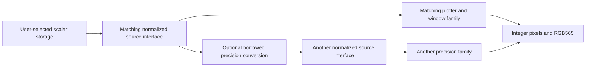

# Selectable floating-point precision

Grafici defaults to `float`. A portable two-byte IEEE 754 binary16 implementation is available as `grafici::Float16`, with typed sources, adapters, windows and plotters. Normalization is an interface convention; the scalar itself supports negative values and values above 1.

```cpp
using Real = grafici::Float16;  // Use float for the default precision.

Real samples[] = {-2.0f, 0.5f, 1.5f, 3.0f};
DataArrayXY<Real, Real> data(samples, 4, {-4, 4});
GraficiT<Real> plot(display);

auto x = data.x();
auto y = data.y();
plot.line(x, y, white);
```

The display is still an `Adafruit_GFX` target. No global build macro is required, and both precision families can coexist in a program. Existing names such as `Grafici`, `Window`, `DataNorm` and `DataFunction` are aliases for their float variants, preserving their ordinary C++11 usage.

## Floating-point headroom is part of the contract

`Float16` stores a sign, a five-bit exponent and a ten-bit fraction. It represents signed finite values up to 65,504, signed zero, infinities, NaNs and subnormals. It rounds to nearest with ties to even. This implementation uses integer bit conversion and ordinary FP32, so it does not require a compiler-provided `_Float16` type. Language and hardware support for native half precision vary independently. [GCC half-precision documentation](https://gcc.gnu.org/onlinedocs/gcc/Half-Precision.html)

```cpp
using Half = grafici::Float16;
Half a = 0.75f;
Half b = 0.75f;
auto intermediate = a + b;  // float, approximately 1.5
Half retained = intermediate;  // binary16, exactly 1.5
Half negative = Half(0.25f) - Half(0.75f);  // -0.5
```

**Crossing 1 is not floating-point overflow.** It is an ordinary result. FP16 overflow occurs near its finite range limit: 65,520 rounds to positive infinity. Arithmetic promotes to float; assigning to a `Float16` field or array rounds the result to binary16. Compound assignments also compute in float and round on assignment. This is a storage-and-computation model with explicit rounding boundaries, not a guarantee of rounding after every arithmetic operator.

UNORM16 represents only `[0,1]`. Saturating or wrapping a sum like `0.75 + 0.75`, a negative difference, a slope or a spline coefficient would change the algorithm. It is therefore unsuitable as the general scalar for this API. A future UNORM16 option belongs in an explicitly normalized sample/grid-storage adapter, decoded to a floating-point computation type before arithmetic. BF16 would preserve more exponent range at the cost of fewer fraction bits; it is not implemented here.

The existing explicit clipping semantics remain: `DataNormT` trims a raw value to its supplied range, and range mapping clamps at its endpoints. A raw value of 2 in `[-4,4]` is valid and normalizes to 0.75. Selecting FP16 does not introduce a universal `[0,1]` clamp or remove the library's existing clipping operations. The display layer projects geometry without per-vertex clamping, rejects non-finite projections, and clips finite lines/triangles before signed pixel conversion. See [boundary contracts](CONTRACTS.md) for validity, missing samples and clipping semantics.

## Choose how much to narrow

The least invasive choice is to compress a retained array while keeping the normal float source interface and rendering pipeline:

```cpp
grafici::Float16 samples[] = {-2, 0, 2};
DataArray<grafici::Float16> source(samples, 3);  // Scalar defaults to float.
Grafici plot(display);
plot.line(source, source, white);
```

This retains FP32 range metadata, normalization results, geometry and spline types. Quantization of the samples still happens before range discovery; widening cannot recover discarded distinctions.

For smaller value objects, ranges and retained coefficients as well, use the same scalar throughout a typed pipeline:

| Existing float API | Explicit precision |
| --- | --- |
| `Grafici`, `Window`, `PolarWindow` | `GraficiT<Real>`, `WindowT<Real>`, `PolarWindowT<Real>` |
| `DataNorm`, `DataVector`, `DisplayVector` | `DataNormT<Real>`, `DataVectorT<Real>`, `DisplayVectorT<Real>` |
| `DataSourceNorm`, `DataParametric`, `DataSelect` | Corresponding `...T<Real>` types. Custom sources derive from this family's interface. |
| `DataFunction`, `DataConstant`, `DataLinear`, `DataResize`, `DataInterpolatorL` | Corresponding `...T<Real>` types. |
| `DataArray<T>`, `DataArrayXY<T>` | `DataArray<T, Real>`, `DataArrayXY<T, Real>`; `T` is the borrowed array's element type. |
| `DataDistributionUniform<N>`, `DataDistributionNormal<N>`, `DataHistogramXY<BINS>` | Add `Real` as the final template argument. Histogram counters remain integers. |
| `DataSpline<N, AUTOSCALE>` | `DataSpline<N, AUTOSCALE, Real>`. |
| `PlotOptions`, `plot_options`, `full_screen` | `PlotOptionsT<Real>{}` and `full_screen_for<Real>()` for the selected family. |

`Range<Real>` and `Vector<Real>` were already templates. Range normalization uses `grafici::ComputationType<Real>::type`; for float and `Float16` that is float. `DataFunctionT<Float16>` consequently accepts a callback returning float, allowing the calculation to finish before the result is stored. Pixel coordinates, sizes, source indices and counts remain integer types. RGB colors/palettes keep their existing representation and float color-map interface; normalized values are widened at that boundary.

Sources and plotters remain independently replaceable within a precision family. To cross families, borrow a converting view:

```cpp
DataDistributionUniform<128, grafici::Float16> compact(123);
DataCast<float, grafici::Float16> source(compact);
// source now implements the ordinary float DataSourceNorm interface.
```

`DataCast<To, From>` converts values and range metadata on access without a second sample buffer. The original source must outlive the view. The same borrowing rule applies to x/y selector views used by interpolation: keep those views in named variables for the lifetime of the interpolator.



## SRAM and numerical limits

| Payload | Float | FP16 |
| --- | ---: | ---: |
| 128 retained samples | 512 bytes | 256 bytes |
| Raw value plus two range bounds (`DataNormT`) | 12 bytes | 6 bytes |
| Coordinate pair | 8 bytes | 4 bytes |
| Three spline coefficient arrays of `N+1` elements | `12*(N+1)` bytes | `6*(N+1)` bytes |

Object metadata, alignment, stack, display buffers and heap overhead are additional. Spline temporary solver arrays use the computation type and remain FP32 in FP16 mode; their peak payload is still `20*n+12` bytes, where `n=source_count-1`. A smaller retained spline does not imply that a large spline construction fits a small Arduino. No per-sample decoding buffer is allocated.

FP16 does not promise faster arithmetic. Decoding, rounding and additional template instantiations can cost CPU time and flash; using both families can retain both implementations. Projection uses the matching computation type and float trigonometry for float/FP16. Memory savings and runtime need to be assessed together on the intended MCU.

Narrowing the entire pipeline also narrows raw range bounds, index-derived coordinates, window parameters and coefficients. Integers stop being consecutive above 2,048, and a small variation on a large raw offset can disappear. Two rounded range endpoints or spline knots can coincide. Keep the float interface/computation and compress only sample buffers when these distinctions matter. Duplicate, reversed or non-finite knots produce an empty interpolator; non-finite spline coefficients are rejected. FP16 quantization can collapse distinct knots and range endpoints, and finite but ill-conditioned systems can still lose accuracy. These checks do not make FP16 suitable for every spline.

For one FP16 conversion of a normalized coordinate, nearest-even rounding has absolute error at most `1/4096`. FP32 pixel scaling turns this into about 0.078 pixels on a 320-pixel axis. Repeated rounding, raw quantization and polar projection have additional error; this bound is not an end-to-end guarantee.

## Verification

The host checks cover all 65,536 binary16 patterns, independent decoding, round trips, all adjacent positive finite rounding intervals and ties, negative values, subnormals, signed zero, NaNs, infinity and finite overflow. They also exercise both source families, borrowed casts, interpolation, splines, histogram/distribution storage, subwindows, polar projection and every plotter. Float and FP16 pipelines also drew into the installed actual Adafruit GFX canvas in a separate host integration check. The spline overflow regression is covered in Grafici-Test. See [test commands](https://github.com/cattanimarco/Grafici-Test/blob/f922bc61317a4e84718346f90e9042bf436b04b5/tests/README.md).

The FP16 example and the existing float `bars_from_c_array` example also build for Arduino Uno R3. A matched 128-sample line sketch gives these linked sizes with Arduino AVR core 1.8.8, AVR GCC 7.3.0, the default `-Os`/LTO settings, Adafruit GFX 1.11.10 and ILI9341 1.6.1:

| Samples / pipeline | Flash | Static SRAM (`.data + .bss`) |
| --- | ---: | ---: |
| Float / float | 27,230 bytes | 954 bytes |
| FP16 / float | 27,836 bytes | 698 bytes |
| FP16 / FP16 | 30,172 bytes | 736 bytes |

Each sketch owns the same 128-element sample array, initializes it with signed values in `[-2,2]`, uses a fixed `[-3,3]` y range and draws the same line and axes. Only the sample and pipeline scalar aliases change. The compact-array option saves 256 bytes of static SRAM at a cost of 606 flash bytes. The full FP16 family saves 218 bytes and costs 2,942 flash bytes. Retaining another family also retains default objects and interface metadata, so reducing individual payloads does not guarantee the smallest linked program.

These are compiler/linker results, not hardware measurements. They exclude runtime heap/stack peaks and do not establish physical display frame rate. The comparison favors FP16 sample storage with a float pipeline as the initial choice when retained arrays dominate SRAM; measure the actual application before narrowing every object.
